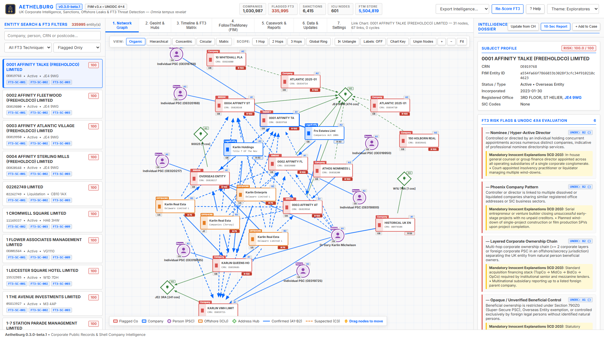

# Interface tour

The window has a top bar and three panels. It is designed for a width of 1280 px or more: narrower than that it scrolls sideways; between 1280 and 1500 px the tabs show short names, the subtitle and two counters are hidden, and buttons wrap onto a second line rather than overlap.

## Top bar

- **Counters**: companies fully imported, companies flagged by FT3 rules, sanctions records, ICIJ Offshore Leaks nodes, entities in the FollowTheMoney store.
- **Export Intelligence…**: downloads the data in one of eight formats; see [Exports](exports).
- **Re-Score FT3**: re-runs entity resolution and all FT3 detection rules on the whole database; see [Risk scoring](risk-scoring).
- **? Help** (or F1): opens this guide on the chapter of the tab you are in; the [FAQ](faq) and the [Version history](version-history) are at the end of the index. Clicking the version number in the top bar opens the version history.
- **Theme**: light, classical or dark.
- **Activity indicator**: a pill that appears next to the actions whenever the program waits for the server for more than half a second, naming what is being waited for (search, dossier, graph, map, Companies House…) and for how long. Red after eight seconds, when the database is busy, or when the server stops answering. While a background task runs (re-score, import, download, officers, backup) it shows the task, the time elapsed and the time left, estimated from its progress or from how long the same task took last time on this computer; click it to open **Data & Updates**.

## Left panel: search and filters

- **Search box**: company name (the start of any word: "fabri" finds CAMILLA FABRI LTD), company number (CRN, with or without leading zeros) or postcode. Companies and the register index are searched as you type; a very common word ("limited") shows the first 10,000 matches. **Enter** also searches people (PSC controllers and officers), which takes a few seconds on a big database: their cards appear at the top of the list with their companies.
- **FT3 technique filter**: only companies flagged by one technique.
- **Risk filter**: all companies, flagged only, high (score 35 or more) or critical (65 or more). The default shows flagged companies only: choose **All Risk Scores** to see everything, including the companies whose only finding is a shared address (they have a small score but are not flagged; see [Risk scoring](risk-scoring)).
- Each result shows name, risk score, CRN, status, postcode and up to three FT3 technique codes. Click it to open the company in every tab.
- Below the results, companies that are only in the **register index** (not imported in full) have a **Fetch** button that downloads them from Companies House (needs the REST key).

## Centre panel: seven tabs

1. [Network Graph](network-graph)
2. [GeoInt & Hubs](geoint-and-hubs)
3. [Timeline & FT3 Matrix](timeline-and-ft3-matrix)
4. [FollowTheMoney](followthemoney)
5. [Casework & Reports](casework-and-reports)
6. [Data & Updates](data-and-updates)
7. Settings: Companies House keys, daily update, backups to keep, hub threshold (see [Companies House API](companies-house-api))

## Right panel: Intelligence Dossier

Profile of the selected company: registry details, cross-dataset hits (sanctions, ICIJ), FT3 flags with UNODC grade and innocent explanations, PSC controllers, officers, co-located companies.

The names of the beneficial owners are links: a person opens their card at the top of the left list, with every company where they are or were a PSC controller or an officer, and is picked out in the network graph; a corporate controller is searched by name.

- **Update from CH**: downloads the current profile, every officer appointment and every PSC statement from Companies House, then starts a re-score of the whole register in the background. See [Companies House API](companies-house-api).
- **10-Sec Report**: opens the intelligence report of the company in a new tab (see [Casework & Reports](casework-and-reports)).
- **+ Add to Case**: adds the company to the active investigation.
