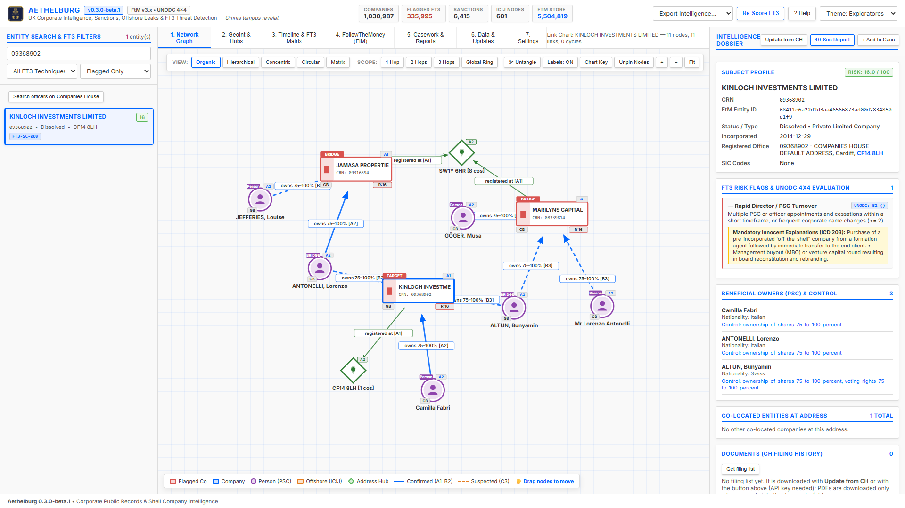

# 1. Network Graph

Link chart of the selected company: companies, PSC controllers (people and legal entities), officers, offshore entities from ICIJ and shared registration addresses.

## Scope

- **1 / 2 / 3 hops**: how far from the selected company the chart extends.
- **Global ring**: overview of the most connected flagged companies instead of one company.

## Layouts

- **Organic**: force-directed layout that tries several placements and keeps the one with the fewest crossing links, then swaps nodes while that removes more.
- **Concentric**: rings by distance from the subject (hop 0, 1, 2).
- **Hierarchical**: ownership from top to bottom.
- **Circular** and **Matrix**: compact views for many nodes.
- **Untangle** re-runs the organic layout with more attempts to reduce crossings further. Nodes you drag are pinned and the chart remembers where you put them (in this browser, for that company); **Unpin Nodes** forgets the arrangement and lays the chart out again.

## Reading the chart

Shapes follow UNODC / i2 conventions; **Chart Key** opens the chart cover (case, date, topology) and the legend beside the chart; the bar under the chart always shows the short legend.

- Rectangles: companies (red = flagged, blue = other, amber = offshore entity from ICIJ).
- Circles: people (PSC, PEP); dashed circles: unknown or unidentified beneficial owners.
- Diamonds: address hubs; octagons: UK sanctions designations.
- Solid line: confirmed link (graded A1 to B2); dashed line: suspected link (C3).

Drag nodes to move them, use the mouse wheel or **+ / −** to zoom, **Fit** to fit the screen and **Labels** to show or hide link labels. Click a company node to open it.
