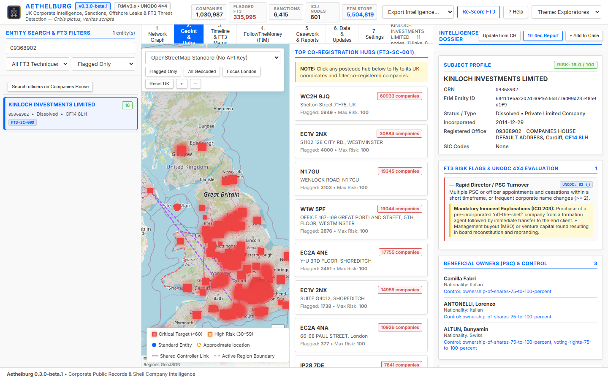

# 2. GeoInt & Hubs

Map of the registered offices and list of the busiest registration addresses.

## Base maps

- **OpenStreetMap Standard / Dark / Humanitarian (HOT)**: online maps, no key needed.
- **Offline UK Vector Only**: outline of the UK regions without any network access.

**Flagged Only** shows flagged companies, **All Geocoded** every company with a position. **Focus London** and **Reset UK** move the view.

## How precise is a position

A company is placed at the centre of its postcode. Each marker carries a precision:

| Precision | Where the marker is | Drawn as |
|---|---|---|
| postcode | centre of the full postcode, from the ONS Postcode Directory | filled marker |
| district | centre of the outward code (e.g. `EC1V`) | dashed ring |
| area | centre of the postcode area (e.g. `B` = Birmingham) | dashed ring |

Dashed rings are approximate, and many companies of the same area sit on the same point. Download and import the **ONS Postcode Directory** in [Data & Updates](data-and-updates) to get exact positions, or run `python -m src.main import-onspd FILE`.

Marker colour: red = critical (score 60 or more), amber = high (30 to 59), blue = other. Purple dashed lines join companies that share a PSC controller.

## Top co-registration hubs

The right column lists the registration addresses shared by many companies (technique FT3-SC-001, at least 20 companies by default; the number is in **7. Settings → Risk scoring**), with the number of companies, how many are flagged and the highest score. Click a postcode to show the companies at that address. A shared address alone never flags a company: the largest hubs are registered formation agents, and the companies worth a look are the flagged ones among their customers.
