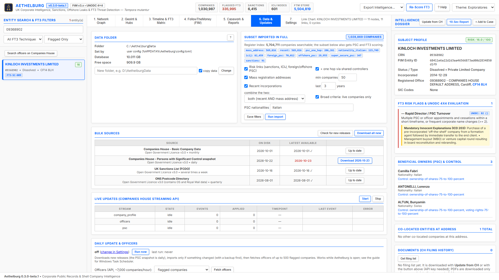

# 6. Data & Updates

This tab answers three questions: where the data is, how fresh it is, and how it is kept up to date.

## How Aethelburg gets its data

| Source | Publisher | Released | What Aethelburg uses it for |
|---|---|---|---|
| Basic Company Data | Companies House | monthly | every UK company: name, status, address, dates, SIC codes |
| PSC snapshot | Companies House | daily | persons with significant control of every company |
| UK Sanctions List | FCDO | several times a week | sanctioned people and entities, UK company numbers they control |
| ONS Postcode Directory | Office for National Statistics | quarterly | exact map position of every postcode |
| Companies House REST API | Companies House | live, on demand | full profile, officers and PSC of one company |
| Companies House Streaming API | Companies House | live, continuous | every change filed at Companies House, as it happens |

ICIJ Offshore Leaks is a static archive and is read from the `ICIJ Offshore Leaks Database` folder in the data folder (or in the old `dati` project folder).

## Data folder

Shows where the downloads, the database, exports and logs are, where the setting comes from and the free space. To move everything: type the new folder, keep **copy data** ticked and press **Change**, then restart Aethelburg. The old folder is kept; delete it yourself once you have checked the new one.

## Bulk sources

For every source: the release on disk and, after **Check for new releases**, the latest one published (shown in red when newer). **Download** gets one source, **Download all** gets them all.

- Files go to `<data folder>\downloads\<source>\<release date>\`.
- A release already on disk is never downloaded again.
- An interrupted download resumes where it stopped when the server allows it, otherwise it starts again.
- Each download is checked with SHA-256 and recorded with its source and date.

## Subset imported in full

The UK register has about 5.7 million companies. Aethelburg keeps **all of them in a light search index** (name, number, postcode, status, incorporation date) and imports **in full**, with PSC controllers and FT3 scoring, only the companies selected by these filters:

- **Risk links**: company numbers and names on the UK Sanctions List, names that match an ICIJ Offshore Leaks entity, a corporate PSC registered outside the UK or in an offshore jurisdiction, a super-secure PSC.
- **+ one hop**: the other companies controlled by the same PSC controllers.
- **Mass registration addresses**: addresses shared by at least *N* companies (default 50).
- **Recent incorporations**: incorporated in the last *N* years (default 3).
- **Combine the two**: *both* keeps only companies that are recent **and** at a mass address (the typical shell profile, about 570,000 companies in October 2026); *either* takes any of them (about 3.1 million, more than half of the register).
- **Live companies only** for the two broad criteria above. Basic Company Data lists live companies only, so this matters for companies added by live updates.
- **PSC nationalities**: companies with at least one individual PSC of these nationalities (default `Italian`; `Italy` written as nationality is recognised too). Officers' nationality is not in the bulk files: open a company and use **Update from CH** to load its officers.

**Save filters** stores your choice (in your user configuration file); **Run import** applies it. The badges show how many companies each criterion selected; a company can match several.

Any other company can still be found with the search box and loaded on demand with **Fetch** (REST key needed).

### What Run import does

1. Builds the search index from Basic Company Data.
2. Selects the subset (reads the 14 GB PSC snapshot up to three times, about 4 minutes each).
3. Imports the full records of the subset, then their PSC statements.
4. Imports the UK Sanctions List and the ONS Postcode Directory.
5. Runs FT3 scoring.

Every step saves its progress: if the window is closed or the computer stops, **Run import** continues from where it stopped. **Recent import runs** shows each step, its release and how many rows it wrote.

## Keeping it up to date

There are two complementary ways.

**Live updates (Streaming API).** Press **Start** (Streaming key needed). Aethelburg then receives every change filed at Companies House:

- companies already imported are updated (profile, officers, PSC);
- new incorporations join the subset when *Recent incorporations* is on;
- a company that gets a foreign, offshore or super-secure PSC, or a PSC of one of the chosen nationalities, joins the subset;
- every company change also updates the search index;
- FT3 scores are recalculated at most every 15 minutes while changes arrive.

Each stream remembers the last event it processed (its *timepoint*), so after a restart it continues from there. The table shows events received and applied, the timepoint and any error.

**Monthly refresh.** The stream can only go back a limited time. If Aethelburg stays off too long the stream reports a gap: then **Check for new releases**, **Download all** and **Run import** bring everything back in line. Doing this once a month (when Companies House publishes a new Basic Company Data) is a good routine even when the stream runs.

**Daily update.** In the *Daily update & officers* card, tick *run every day at* and choose a time: while Aethelburg is open it downloads new releases every day (the PSC snapshot is daily), imports only when something changed (with a backup first) and fetches officers of up to 500 flagged companies. A day missed while the program was closed is caught up at the next start; **Run now** starts it immediately. With *also download latest documents* ticked it also downloads the latest accounts and confirmation statement PDFs of the 50 highest-risk flagged companies. For a run with Aethelburg closed, schedule `data daily` with Windows Task Scheduler (see the [FAQ](faq)).

**Officers.** Officers are not in the free bulk files: **Fetch officers** downloads them from the API for the flagged companies, the companies of the active case or the whole subset (about 7,000 companies per hour; the run resumes and skips companies fetched in the last 30 days).

**One company now.** **Update from CH** in the dossier refreshes a single company immediately.

## Recent changes

Every update compares a company already in the database with the new data and records what changed: address, status, name, category, SIC codes, dissolution date, accounts and confirmation statement filed, number of charges, officers appointed or resigned, PSC added or ceased. The card lists the latest changes with the old and new value, the date observed and the source; choose a type or *subset only* to filter, and **CSV** to export them all. Click a company number to open it. The first load of a company is not a change, so the list fills only from the second import, stream event or **Update from CH** onwards. The same changes appear in the company's [timeline](timeline-and-ft3-matrix).

## Backups

**Back up now** copies the database to the `backups` sub-folder (safe while an import runs) and checks the copy; a backup is also made before every import, and the newest 7 are kept. **Restore** replaces the database with a backup after backing up the current one; restart Aethelburg afterwards.

From the command line: `data status`, `data download`, `data import`, `data watch`; see [Command line](cli-reference).
